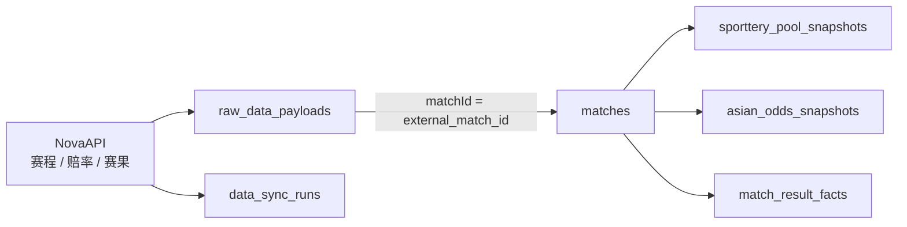
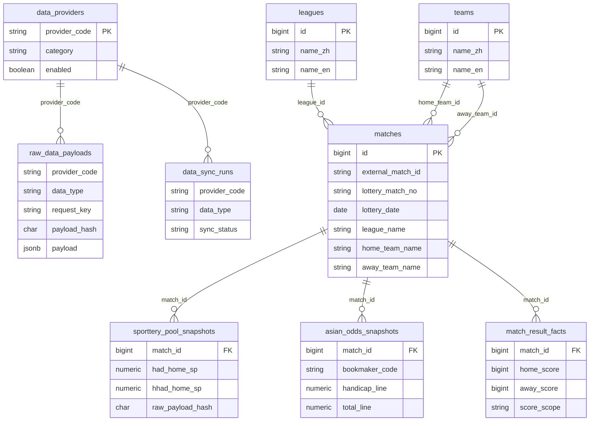
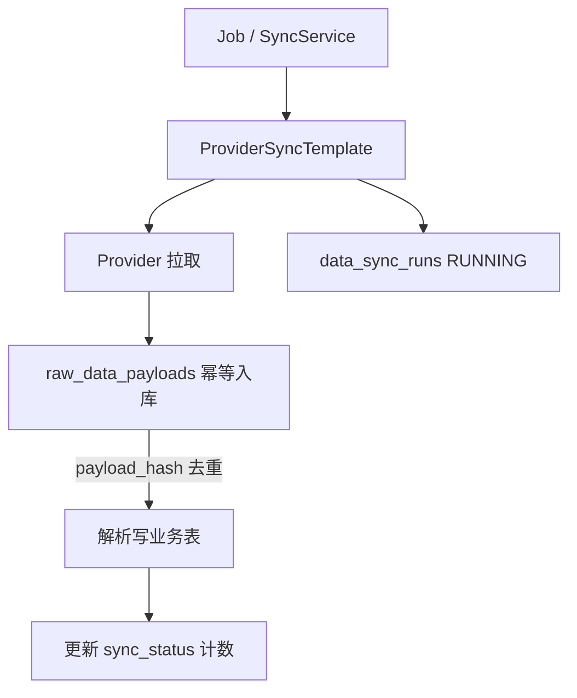
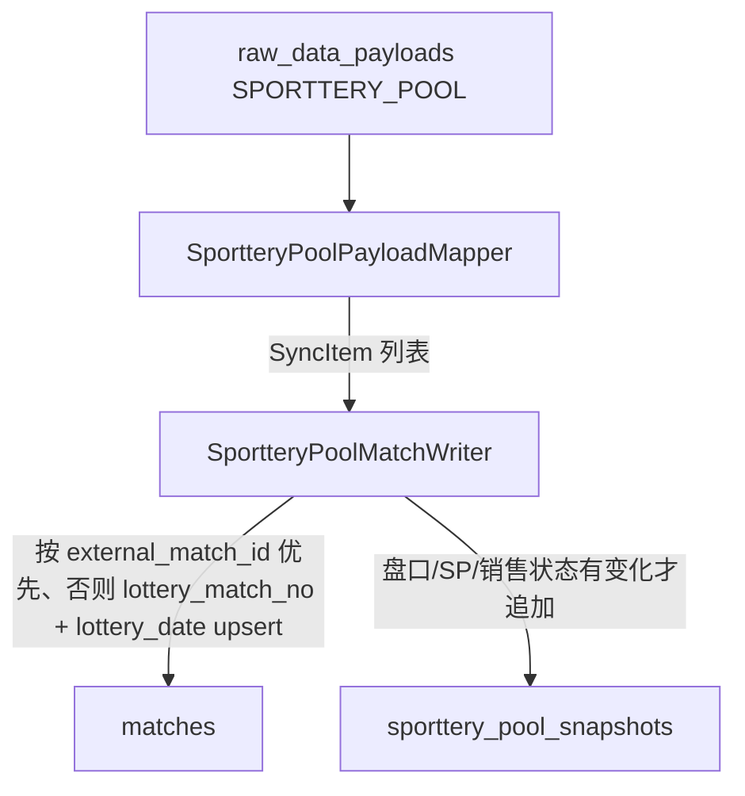
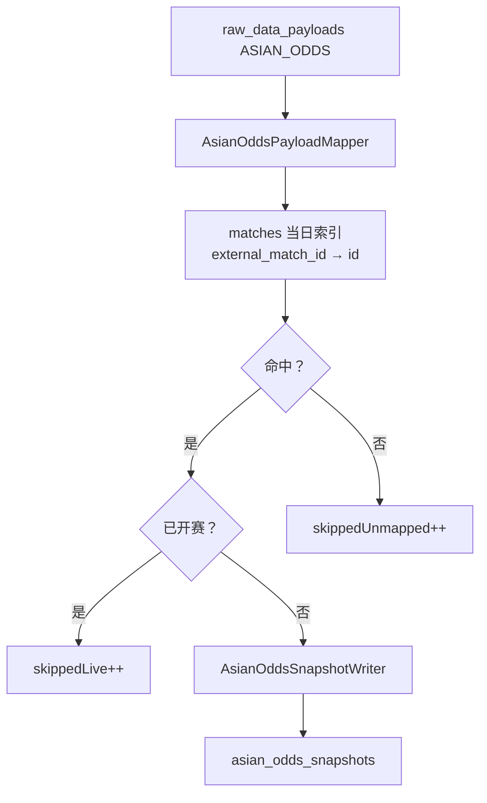
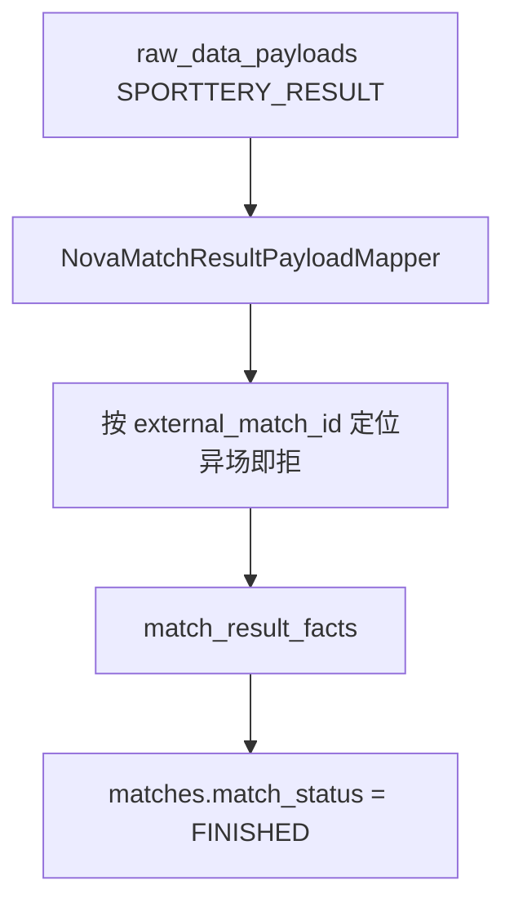

# 业务数据流转与表关系

- 文档版本：v0.3
- 最后更新：2026-10-25
- 作用：说明当前已落地表之间的关系，以及赛程 / 亚盘 / 赛果如何落到同一场比赛
- 权威表结构：`backend/src/main/resources/db/migration/V1`～`V26`
- 相关设计：`technical-design.md`；任务进度：`dev-tasks.md`

> 本文回答「数据怎么流、表怎么连」。预测发布、结算的表结构见 `technical-design.md` M3/M4，本文不展开。
>
> **v0.3 的关键变化**：数据源已收敛为 NovaAPI 单源，映射层（`match_source_mappings`、
> `provider_league_mappings`、`provider_team_mappings`、`league_aliases`、`team_aliases`）
> 在 V26 被物理删除。本文原先描述的三张「映射」表与名称归一化流程已不存在。

## 1. 一句话总览

**NovaAPI 的 `matchId` 就是竞彩场次 ID**：赛程、亚盘赔率、赛果三个接口返回同一个 ID，
落库时统一存到 `matches.external_match_id`，之后所有外部数据都按它直连到 `matches.id`。

## 2. 表关系总图（当前库）

### 2.1 已删除的映射层（V26）

| 表 | 曾经的作用 | 为什么删 |
| --- | --- | --- |
| `match_source_mappings` | 供应商外部比赛 ID → `matches.id` | 单源后 `external_match_id` 直接就是竞彩场次 ID，不需要映射 |
| `provider_league_mappings` / `provider_team_mappings` | 供应商外部联赛/球队 ID → `leagues.id` / `teams.id` | 同上：联赛与球队名称直接来自载荷，不做 ID 对齐 |
| `league_aliases` / `team_aliases` | 人工确认的名称别名 → 标准 ID | 名称归一化链一并删除，`NameNormalizationSupport` 只留 V22 迁移的历史依赖 |

生产库删除前实测：5 张表共 45 行，**全部属于已停用的 `THE_ODDS_API`**，`NOVA_API` 一行都没有。

## 3. 接入层流转

每次同步先记运行，再幂等存原始 JSON，再解析写业务表。

要点：

- `data_providers`：注册源（不含密钥）。
- `data_sync_runs`：一轮同步的状态机与额度统计。
- `raw_data_payloads`：`(provider_code, data_type, request_key, payload_hash)` 唯一，保证同内容不重复落库。
- `code != 200` 一律整体失败，不做逐场降级——否则「密钥过期」会表现为「同步成功、快照 0 条」。

## 4. 赛程同步（`SportteryPoolSyncService`）

| 步骤 | 写入 | 说明 |
| --- | --- | --- |
| 1 | `matches` | 必写 `external_match_id`；唯一键 `(lottery_match_no, lottery_date)`；写 `league_name` / 主客队展示名 |
| 2 | `sporttery_pool_snapshots` | 只追加；与上一快照盘口内容相同则跳过 |

`matchStatus` 是**销售状态**（`Selling` / `SoldOut` / `Closed`），不是比赛状态；`FINISHED` 只能由赛果写入方设置。

## 5. 亚盘同步（`AsianOddsSyncService`）

硬性规则：

- **只按 `external_match_id` 直连**。查不到就是 `skippedUnmapped`，不做「猜一场」的兜底匹配。
- **开赛判定必须在此拦截**：`/nova/tf/odds` 不返回滚球标志，而本表写的是赛前快照，冻结行按它计账。
- 交叉积落库：同一场同一次抓取会写入「让球线 × 大小球档」的全部组合，读侧必须按 `(handicap_line, total_line)` 去重，
  否则会把不同的档当成同一条线的不同报价。

## 6. 赛果同步（`MatchResultSyncService`）

- 只读 `sectionsNo999`（竞彩 90 分钟比分），`etHomeScore/etAwayScore` 是加时阶段自身比分，不能与 `ft` 相加。
- `matchResultStatus != 2` 即未开奖，解析器**整体失败**而不是逐条跳过——逐条跳过会让该场永久停在 `PENDING`。
- 赛果 `matchDate` 是**开赛自然日**，与赛程的 `matchDate`（竞彩业务日）同名不同义，所以定位只能用 `matchId`。

## 7. `matches` 字段怎么理解

| 字段 | 含义 |
| --- | --- |
| `id` | 内部比赛主键；快照、赛果、预测都挂这里 |
| `external_match_id` | NovaAPI 的 `matchId`，**赛程/赔率/赛果的唯一直连键** |
| `lottery_match_no` + `lottery_date` | 体彩官方身份（竞彩业务日），产品侧「一场竞彩」的自然键 |
| `league_name` / `home_team_name` / `away_team_name` | 同步时的展示名 |
| `league_id` / `home_team_id` / `away_team_id` | 标准字典外键；可空，前端联赛下拉由 `league_id !== null` 反推，**不填会让筛选静默消失** |
| `match_status` | 内部状态机（`SCHEDULED` / `LOCKED` / `FINISHED` / …） |
| `home_score` / `away_score` | 赛果同步后写入 |

## 8. 与代码的对应关系（便于跳转）

| 流转 | 主要类 |
| --- | --- |
| 同步模板 | `data.service.ProviderSyncTemplate` |
| 赛程同步 | `SportteryPoolSyncServiceImpl` → `SportteryPoolPayloadMapper` → `SportteryPoolMatchWriter` |
| 亚盘同步 | `AsianOddsSyncServiceImpl` → `AsianOddsPayloadMapper` → `AsianOddsSnapshotWriter` |
| 赛果同步 | `MatchResultSyncServiceImpl` → `NovaMatchResultPayloadMapper` → `MatchResultFactWriter` |
| 业务日流水线 | `DataPipelineServiceImpl`（赛程 → 亚盘 → 覆盖率，无标准化阶段） |

## 9. 变更记录

| 日期 | 说明 |
| --- | --- |
| 2026-07-24 | 初版：基于 V1～V4 与 T202/T203 落地情况整理表关系与主链路图 |
| 2026-07-24 | 补充 T204：MatchMappingService 打分/待复核与 V5 解释候选列 |
| 2026-07-24 | 补充 T206：亚盘快照同步与 AH/totals 写入 |
| 2026-07-25 | 规划校准：权威 migration 更新到 V1～V6，未串通的数据链路明确由 T207 收口 |
| 2026-10-25 | v0.3 单源收口：删除映射层五张表与名称归一化链（V26），数据流改为按 `external_match_id` 直连；补充赛果同步 |
